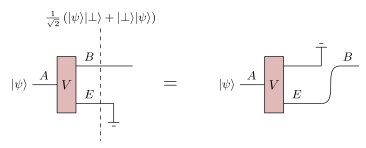

This is a condensed version, with figures, of an argument appearing in Ref.[^preskillchap7]
{.note}

The quantum capacity \(Q(p)\) of the erasure channel \(\mathcal{N}:\rho\mapsto (1-p)\rho + p\lvert\perp\rangle\langle\perp\rvert\) is zero if \(p\geq 1/2\) and
$$
Q(p)=1-2p \quad \forall p\in [0,1/2).
$$
The attainability of this rate can be proven using random stabilizer codes and a probabilistic existence argument[^preskillchap7],[^wilde]. (Perhaps I will update with this direction later.) In the remainder of this note we proof-sketch the upper bound.

Let \(Q\equiv Q(p)\). If Alice and Bob are allowed \(m\) uses of the identity channel combined with \(n\) uses of the erasure channel, then they can reliably encode at most \(m+Qn\) qubits for large \(m\) and \(n\)[^footnote1]. Now, suppose we have \(0\leq p\leq 1/2\), and imagine Alice can protect \((1-2p)\) of the qubits (as a fraction) from the noise, but each of the remaining qubits are sent through an erasure channel with parameter \(1/2\). Then the above argument tells us the rate in this situation is at most \(R(p) \equiv (1-2p)+Q(\tfrac{1}{2})\).

However, for a large enough number of sent qubits, the above noise model is equivalent[^footnote2] to erasure with probability \(p\), with the extra knowledge of which qubits are protected. That knowledge can only help, so \(Q(p)\leq R(p)\).

Finally, \(Q(\tfrac{1}{2})\) is necessarily zero for the following reason. When \(p=1/2\) one complementary channel of the erasure channel is the *same* erasure channel:

{width="30em"}

Thus any protocol with nonzero rate used by Bob could just as well be used by Eve to prepare the encoded state in her register, resulting in two transmitted copies of the encoded state each with arbitrarily high fidelity:

 so long as the rate is nonzero. Since this is impossible, we conclude the channel has zero rate.")
{width="20em"}

This violates no-cloning and is therefore impossible.

[^preskillchap7]: J. Preskill. "Chapter 7: Quantum Error Correction". *Lecture Notes for Physics 219 at Caltech*. (Retrieved Feb 2026.) <https://www.preskill.caltech.edu/ph229/notes/chap7.pdf>

[^wilde]: M. Wilde. "From Classical to Quantum Shannon Theory". *Cambridge University Press* (2016). [arXiv](https://arxiv.org/abs/1106.1445)

[^footnote1]: Otherwise, we could employ \(m/Q + n = (m+Qn)/Q\) uses of \(\mathcal{N}\) to simulate that protocol, and if the number of encoded qubits exceeds \(m+Qn\), the rate is strictly greater than \(Q\), a contradiction.

[^footnote2]: Why? The fraction of erased qubits is equal to \(p\) in expectation, and concentrates around this value when the number of sent qubits is large.
