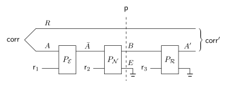
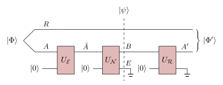

We can explain the criteria for quantum error correction[^klqec] starting from simple classical ideas and then promoting them to their quantum counterparts. This is my preferred rendition of the story because it contains a number of threads which you can follow to explore other fundamental results in information theory, quantum and otherwise. It is also a tale that aligns with modern teachings (in my experience), and makes explicit the connection to classical error correction.

## Classical error correction

Let’s focus on getting criteria for classical error correction for now. First, we need to define what it means to perform error correction. Suppose we define the task naively as reproducing some initial classical state (probability vector) after some noise (a stochastic map) acts on it. We could set as our metric for success the total variation distance between initial and final states. What’s wrong with this picture? Well, it doesn’t capture what we mean by error correction: one option would be to just ignore the corrupted message entirely and replace it with some independent but identically distributed random variable, which “succeeds“ at this task. Clearly, we need to define the task another way, one that captures the idea of decoding the message that was actually sent. This can be accomplished with a different picture:

{width="35em"}

We have introduced a reference system “R”, and the correct version of the task is to demand that the decoding procedure preserves correlations with R. Namely, if the initial state is (using the letter “e” to denote unit vectors)
$$
\textsf{corr}_{RA} = \frac{1}{2^k}\sum_{x\in\{0,1\}^k}\textsf{e}_x\otimes \textsf{e}_x\in \left(\mathbb{R}^{\{0,1\}^k}\right)^{\otimes 2}
$$
we want the final state to satisfy
$$
\textsf{corr}^\prime_{RA^\prime} = \textsf{corr}_{RA}.
$$
The system \(R\) knows the true value of the message that was sent, and if the decoding procedure is successful, it better output a message that matches that value. If instead,
$$
\textnormal{TV}(\textsf{corr}^\prime_{RA^\prime},\textsf{corr}_{RA}) = \epsilon
$$
that would be a reasonable definition for [approximate error correction](#aqec).

That explains R, but what about E? This system is motivated by the following observation: Random, classical noise can be “purified” to *permutations* acting on a larger system, where the new system may start in a random state. That’s why we have used the letter “P“ for these operations. In physics, you might say we are coupling the system to a bath, or *environment*. That environment will contain information about which permutations are applied, and to get an arbitrary noise process (stochastic map) acting on the classical message we can discard the environment, or marginalize. You might think of the environment as containing information about the full syndrome of the noise, that would allow for the correct diagnosis every time if only we could see it. In another context, we might say this is the memory of a demon. We can therefore always express an irreversible noise process in the form that appears thrice in Figure 1.

Our intuition is then as follows. Perfect error correction ought to be possible whenever the register B contains all the information stored in R. In turn, this is true if and only if
$$
\mathrm{I}(R:E|B)_{\textsf{p}} = 0
$$
at least, in the setting we have described above. In words, we want the environment to not have any information about the reference system besides what is already contained in the system B.

Why does that condition suffice? Well if it is satisfied, we can cook up an explicit procedure. First note the intermediate state in Figure 1 is necessarily of the form
$$
\textsf{p}_{BRE} = \sum_{b}\textsf{p}_B(b)\left(\textsf{e}_b\otimes \textsf{p}_{R|B=b}\otimes \textsf{p}_{E|B=b} \right).
$$
Now consider a recovery procedure that only acts on B. It starts by looking at the content of the B register without disturbing it and, conditioned on the value it sees, prepares the appropriate state in a new environment:
$$
\textsf{e}_b\mapsto \textsf{e}_b\otimes \textsf{p}_{E|B=b}.
$$
Then this procedure has exactly reproduced the state prior to discarding the information in E, and we can do a final step of running the noise permutation in reverse to get the initial, perfectly correlated state (after the encoding), without touching the reference system.

## Quantum error correction

{width="35em"}

Two aspects of the above explanation change in the quantum picture, depicted above. First all states and processes are converted to their natural quantum analogues: the perfectly correlated state is now maximally entangled across the subspaces spanned by the codewords; the environment is in some quantum state initially; and the reversible classical dynamics become unitary. Second, the quantum error correction condition[^ns1996qec] becomes
$$
\mathrm{I}(R:E)_{\psi} = 0
$$
without any conditioning. Besides conditioning being a subtle concept quantumly, there is an obvious reason for the change: we cannot simply peer into the register B without disturbing it, or copy its contents (no-cloning). Therefore, we now want the environment to not have any information about R, regardless of B. Quantum states are more delicate: any leakage to the environment at all is bad news.

What is the new procedure that we get when the above condition on the mutual information is satisfied? The explicit procedure comes from the observation that we must have an intermediate mixed state of the form
$$
\textnormal{tr}_B(|\psi\rangle\langle\psi|) = \frac{I}{2^k}\otimes \rho_E.
$$
As an aside, you can check that this is equivalent to the more common [version](https://errorcorrectionzoo.org/c/qecc_finite) of the quantum error correcting conditions,
$$
\langle\bar{i}|E_a^\dagger E_b|\bar{j}\rangle = \delta_{ij}(\rho_E)_{ab}
$$
where \(\{|\bar{i}\rangle\}\) is some orthonormal basis for the code subspace and \(\{E_a\}\) are the Kraus operators for the noise channel.
The fact that we have a product state comes from the mutual information condition, and the reduced state on the reference system is clearly maximally mixed because we started in a Bell state. We can then pick a different purification of this mixed state, one that is of the form
$$
\Phi_{RA}\otimes \psi_{EE^\prime}.
$$
And by the unitary equivalence of purifications, there must exist an isometry
$$
W:|\psi\rangle_{RBE}\mapsto |\Phi\rangle_{RA}\otimes |\phi\rangle_{EE^\prime}
$$
that acts trivially on the reference and environment.

## Approximate error correction {#aqec}

What happens if
$$
I(R:E|B) = \underset{B}{\mathbb{E}}\ \mathrm{D}(p_{RE|B}||p_{R|B}\otimes p_{E|B}) = \epsilon
$$
classically? Then a straightforward exercise is to show (by [Pinsker's](https://en.wikipedia.org/wiki/Pinsker%27s_inequality), Triangle, concavity of square-root) that we have
$$
\lVert p_{RBE} - q_{RBE}\rVert_1 = O(\sqrt{\epsilon}), \qquad q_{RBE}\equiv\mathbb{E}_B\ p_{R|B}\otimes p_{E|B}.
$$
Furthermore, this is a good starting point to show that the procedure we outlined above gives a state that is pretty close in TV distance to the desired "perfectly correlated" initial state, which lines up with what we mentioned would constitute a good definition of approximate error correction.

[^klqec]: E. Knill and R. Laflamme. "Theory of quantum error-correcting codes". *Physical Review A* 55, 900 (1997). [arXiv](https://arxiv.org/abs/quant-ph/9604034)

[^ns1996qec]: B. Schumacher and M.A. Nielsen. "Quantum data processing and error correction". *Phys. Rev. A* 54, 2629 (1996). [arXiv](https://arxiv.org/abs/quant-ph/9604022)
